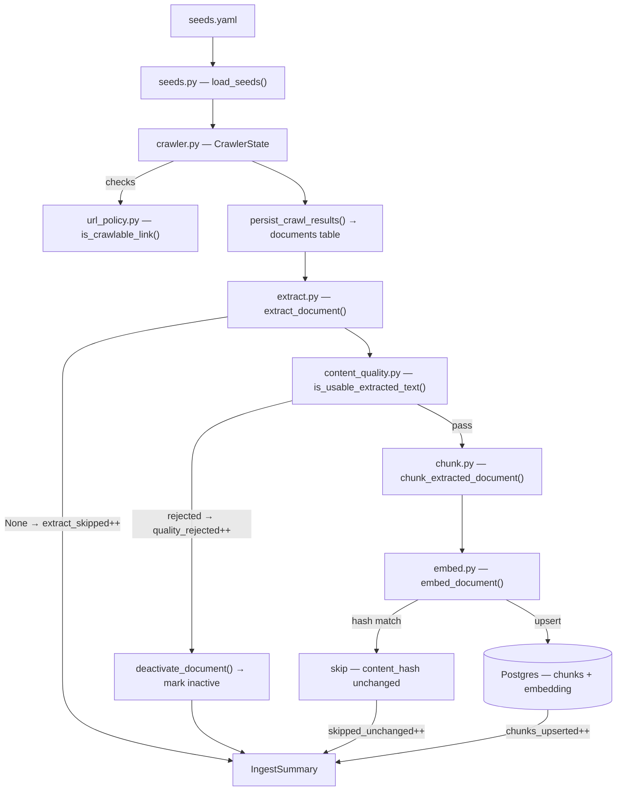
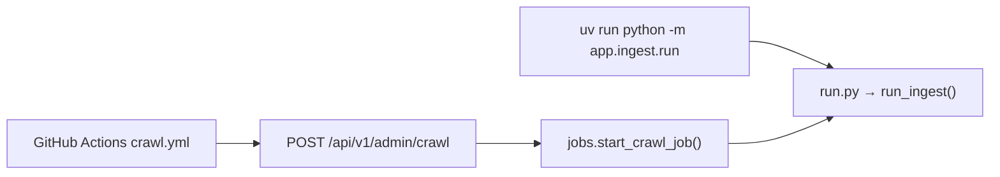
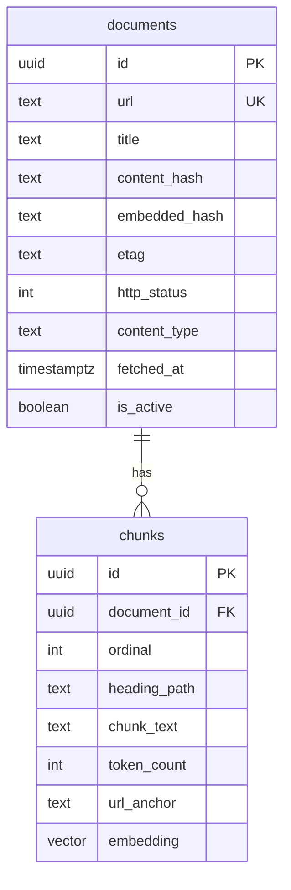
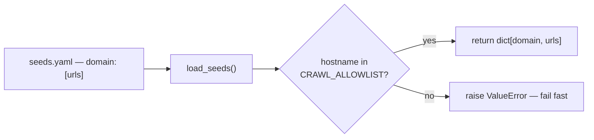
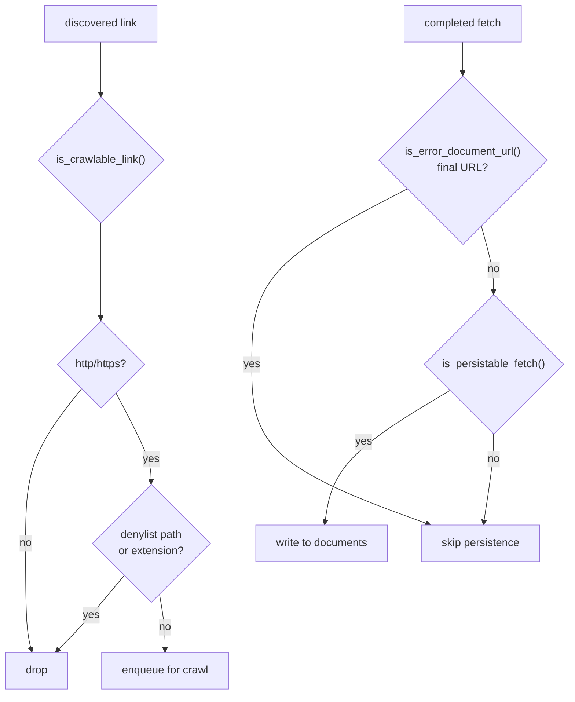
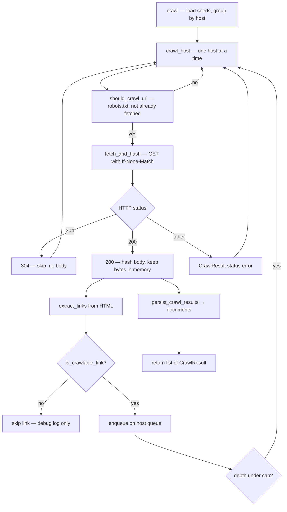
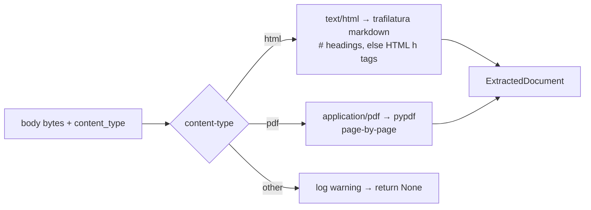
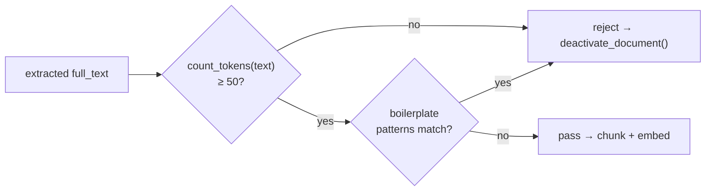
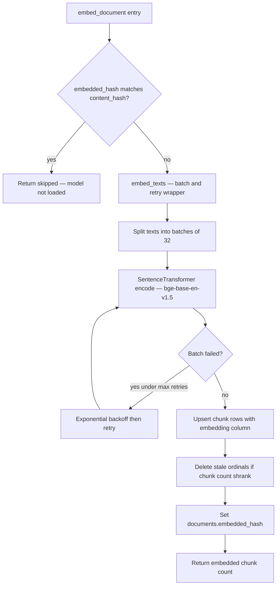

# Ingest pipeline — Ingest pod

Turns Laurier's public web pages into an indexed, searchable knowledge base.

**Invariant you own: INV-1.** Only public Laurier pages enter the index. The hostname allowlist is `CRAWL_ALLOWLIST` in `app/core/config.py`; `robots.txt` is respected without exception; the crawler identifies itself with a contact address.

**Embedding model:** BAAI/bge-base-en-v1.5 (768-dim), run locally on CPU via sentence-transformers — zero API cost, no key required. See ADR-006 in [SDD §13](../../../docs/SDD.md#13-architecture-decision-records).

Spec: [SDD §5.1](../../../docs/SDD.md#51-ingest-pipeline) and [issue #6](https://github.com/LaurierCS/locah-ai/issues/6).

---

## Pipeline overview



Each page is wrapped in its own try/except — one bad page never aborts the rest. Errors are logged and counted in `summary.errors`.

---

## Entry points

Three ways to run ingest:



```bash
cd backend
uv run alembic upgrade head            # apply schema if needed
uv run python -m app.ingest.run        # full crawl → embed
uv run python -m app.ingest.run --force  # re-embed even unchanged pages
```

`DATABASE_URL` is read from the environment or from `backend/.env` / `.env` at the repo root.

**Note on scope:** The GitHub Actions workflow sends `{"scope":"high_churn"}` or `{"scope":"full"}` in the request body, but the backend does not parse that field yet ([issue #100](https://github.com/LaurierCS/locah-ai/issues/100)). Both calls currently run a full `run_ingest()`. The schedule itself is real: nightly at 05:00 UTC for high-churn pages, full crawl every Sunday at 04:00 UTC.

**Ingest summary output:**

```
=== Ingest summary ===
  Pages fetched:      142
  Chunks upserted:    1834
  Skipped unchanged:  98
  Extract skipped:    4
  Quality rejected:   2
  Errors:             0
```

- **Pages fetched** — pages where extraction/chunking/embedding was attempted (status=success with a body).
- **Chunks upserted** — chunk rows written across newly-embedded pages.
- **Skipped unchanged** — pages where `content_hash` matched `embedded_hash` (idempotent re-runs).
- **Extract skipped** — pages where extraction returned nothing (unsupported content-type or empty body).
- **Quality rejected** — pages that passed extraction but were flagged as thin/boilerplate content.
- **Errors** — pages that raised an unhandled exception; pipeline logged the traceback and continued.

---

## Where ingest lands in Postgres

Ingest writes **`documents`** (one row per URL) and **`chunks`** (many rows per page, each with text + embedding).



Column meanings: **`documents.url`** — canonical page; **`content_hash`** — fingerprint of the latest fetched body; **`embedded_hash`** — `content_hash` at last successful embed (`NULL` if never embedded); **`is_active`** — `false` after quality rejection. **`chunks.ordinal`** — 0-based position on the page; **`chunks.chunk_text`** — stored as column `text` in SQL (shown here as `chunk_text` because `text` is awkward in Mermaid).

**Keys that matter:** `(document_id, ordinal)` is unique — re-embedding upserts by that pair and deletes higher ordinals if the page shrinks. **`content_hash`** changes whenever the crawler sees new bytes; **`embedded_hash`** records what was embedded last. When they match, `embed_document` skips the model ([migration `003`](../../migrations/versions/003_add_embedded_hash.py)).

---

## Files

### `seeds.yaml` + `seeds.py`

`seeds.yaml` is the hand-curated list of starting URLs grouped by topic (advising, academic calendar, co-op, registrar, wellness, etc.). `seeds.py` reads and validates it.



`load_seeds()` raises `ValueError` immediately if any seed URL's hostname is not in `CRAWL_ALLOWLIST`. This catches misconfigured seeds at startup rather than silently crawling off-scope hosts.

**In plain terms:** `seeds.yaml` is the list of Laurier pages we intentionally start from; `seeds.py` loads that list and makes sure every URL is on an allowed host before the crawler runs.

---

### `url_policy.py`

Three pure predicates that decide what the crawler does with URLs. They live here — not in `crawler.py` — so they can be unit-tested without spinning up an HTTP client.



- `is_crawlable_link` rejects asset files (`.css`, `.js`, images, fonts), infrastructure paths (`/_ato/`, `/dist/`, `/.well-known/`), and anything without an http(s) scheme.
- `is_error_document_url` catches Laurier's 404 helper pages by looking at the final URL after redirects (e.g. paths containing `/404/404.html` or query params like `req=`).
- `is_persistable_fetch` guards what actually gets written to `documents` — only real 200 responses with accepted content-types.

**In plain terms:** This file is the bouncer for URLs — it skips junk links like CSS and images, ignores Laurier’s “page not found” traps, and only saves fetches that are real content pages.

---

### `crawler.py`

The main crawler. `CrawlerState` manages the HTTP client, per-host queues, robots.txt caching, and the collected `CrawlResult` list. `crawl()` is the public entry point.



URLs on the queue were allowlisted when enqueued (seeds via `normalize_url`; discovered links only if they passed `is_crawlable_link`). The fetch loop does **not** call `is_crawlable_link` again before GET.

Key behaviours:
- Politeness: ≥ 1 s delay per host, one concurrent connection per host, descriptive `User-Agent` with a contact address.
- Etag caching: sends `If-None-Match` on revisit; a 304 means the page hasn't changed and the body is not reprocessed.
- Content is hashed from raw bytes so PDFs and HTML stay consistent with the stored hash.
- `CrawlResult.body` and `.content_type` are kept in memory so the orchestrator can pass them straight to `extract_document` without re-fetching.

**In plain terms:** The crawler walks Laurier’s site from the seed URLs, follows links within the rules, downloads each page (or skips it if unchanged), and records what it found so the next steps can read the page without hitting the web again.

---

### `extract.py`

Strips boilerplate and turns raw bytes into structured sections for the chunker.



**`ExtractedDocument`** fields:

| Field | Meaning |
|-------|---------|
| `title` | Page title when available |
| `full_text` | All block text joined with blank lines |
| `blocks` | Tuple of `ExtractBlock` |

Each **`ExtractBlock`** carries:

| Field | Meaning |
|-------|---------|
| `text` | Section body (plain text) |
| `heading_path` | Breadcrumb, e.g. `Registrar > Fees`; `Page N` for PDF |
| `anchor_id` | HTML `id` on the source heading for `#fragment` citations; `None` for PDF |
| `char_start` / `char_end` | Character offsets in `full_text` (Python string indices) |

For HTML, trafilatura emits **markdown**; sections are split on `#` heading lines when present. If there are no markdown headings, the code falls back to `<h1>`–`<h6>` inside `<main>` / `<article>`. For PDF, pypdf reads page text and labels each block `Page {n}`.

**In plain terms:** Given raw HTML or PDF bytes, this step pulls out the actual article text — not the nav bar or footer — and tags each section with a heading trail so answers can point to the right part of the page.

---

### `content_quality.py`

Runs after extraction, before chunking. Decides whether the extracted text is worth keeping.



- **Token floor (50 tokens ≈ 67 words):** catches navigation shells, empty redirect pages, and anything trafilatura technically extracted but that has no real prose.
- **Boilerplate fingerprints:** regex patterns for OneTrust cookie consent copy, privacy preference centres, and similar CMS-injected content that occasionally leaks through trafilatura's main-content extraction.
- Rejected pages: `deactivate_document()` marks the `documents` row `is_active=False` and deletes any existing `chunks` rows so the page never surfaces in search. The audit row stays.

**Known issue:** boilerplate regexes run on the **full** page text — a single cookie-banner phrase **anywhere** rejects the whole document ([issue #99](https://github.com/LaurierCS/locah-ai/issues/99)). Comments in code mention “near the start” but the implementation does not limit matches to a prefix.

**In plain terms:** After extraction, this step asks “is there enough real text here?” Pages that are mostly cookie banners or empty shells get pulled out of search so students don’t get junk hits.

---

### `chunk.py`

Splits an `ExtractedDocument` into overlapping, citation-ready segments.

**Strategy (as implemented today):**

1. Each `ExtractBlock` from extract keeps one `heading_path`; chunking splits **within** a block on `\n\n` paragraphs (blocks already align with sections).
2. Target ~800 **heuristic** tokens per chunk (`count_tokens` ≈ `words * 0.75`).
3. Overlap between consecutive chunks is **paragraph-based**, aiming near 120 heuristic tokens but often **one or more full paragraphs** (can exceed 120 in real tokens).
4. Drop chunks smaller than 50 heuristic tokens.

**`Chunk`** fields:

| Field | Meaning |
|-------|---------|
| `text` | Plain text content |
| `heading_path` | Breadcrumb from its `ExtractBlock` |
| `char_start` / `char_end` | Offsets in `full_text` (currently section-level in code, not per-chunk precise) |
| `url_anchor` | HTML anchor id for `#fragment` deep-links in citations |
| `token_count` | Heuristic from `count_tokens` — not the bge or Claude tokenizer |

**Known issues:** the heuristic **undercounts** real tokens (chunks can be much longer than 800 in bge’s 512-token window). Overlap and sizing need work for the embedding model — track in [issue #97](https://github.com/LaurierCS/locah-ai/issues/97). Heading/title context in vectors is [issue #98](https://github.com/LaurierCS/locah-ai/issues/98).

**In plain terms:** Long pages get cut into bite-sized passages with a bit of overlap, each tied to a heading, so search can return a specific paragraph instead of an entire 20-page PDF.

---

### `embed.py`

Turns chunk text into dense vectors and upserts them into `chunks.embedding`. The **embedding model** only runs in the encode step below — not during crawl, extract, or chunk. At ingest time, each chunk’s `text` is passed through [BAAI/bge-base-en-v1.5](https://huggingface.co/BAAI/bge-base-en-v1.5) via `sentence-transformers` (`settings.embedding_model`). The model outputs a **768-dimensional, L2-normalized** vector per chunk. Those vectors are what retrieval will compare to a question embedding later (pgvector cosine / HNSW). Hash checks and SQL upserts happen around the model; they do not call the model.



- **Where the model runs:** `embed_texts` calls the cached `SentenceTransformer` encoder (or a test `encoder=` mock). `embed_document` only orchestrates DB reads/writes and invokes `embed_texts` when the page content hash changed.
- **Idempotency:** `embedded_hash` (migration `003`) stores the last successfully embedded `content_hash`. A match skips encode entirely — no model load, no vectors computed.
- **Batching + retry:** batches of 32; up to 4 retries with exponential backoff per failed batch.
- **Upsert + cleanup:** rows keyed by `document_id` + `ordinal`; extra ordinals from a previous run are deleted. Vectors are written as pgvector literals on the `embedding` column.
- **`Encoder` injection:** pass `encoder=` into `embed_document` / `embed_texts` in tests so CI never downloads the Hugging Face weights.

**In plain terms:** Each chunk’s words are turned into a numeric fingerprint the database can compare to future questions. If the page hasn’t changed since last time, this step skips the model entirely and leaves the old vectors in place.

---

### `pipeline.py`

The orchestrator. Wires `crawl()` → `extract_document()` → `is_usable_extracted_text()` → `chunk_extracted_document()` → `embed_document()` in a single pass with per-document error handling.

| Function | Purpose |
|----------|---------|
| `run_ingest(session)` | Full end-to-end: crawl seeds, persist document rows, then process |
| `process_crawl_results(session, results)` | Extract/chunk/embed a pre-crawled list; useful when you already have `CrawlResult`s |
| `IngestSummary` | Dataclass counting pages, chunks, skips, rejections, and errors |
| `format_ingest_summary(summary)` | Human-readable multi-line string for CLI and log output |

Both `run_ingest` and `process_crawl_results` accept `encoder=` for test injection and `force=True` to bypass the hash check.

**In plain terms:** This is the conductor — it runs crawl, then extract, quality check, chunk, and embed in order for every page, counts what happened, and keeps going even when one URL blows up.

---

### `run.py`

CLI entry point. Parses `--force`, creates an async engine, calls `run_ingest()`, and prints the summary to stdout. Logs go to stderr.

See the [Entry points](#entry-points) section above for usage.

**In plain terms:** When you run ingest from your laptop, this script is what you invoke — it connects to the database, runs the full pipeline once, and prints the summary at the end.

---

### `jobs.py`

Background job state for the `POST /api/v1/admin/crawl` endpoint. Tracks one in-process job at a time — a second request while one is running returns 409 immediately. A job moves `running` → `succeeded` when `run_ingest()` finishes, or `running` → `failed` on an unhandled exception.

`CrawlJob` is a plain dataclass (`job_id`, `status`, `started_at`, `finished_at`, `summary`, `error`). State is in-process — it resets on server restart. This assumes a single API worker, which holds for the current single-instance deployment.

**In plain terms:** When cron or an admin hits the crawl API, this file kicks off ingest in the background and remembers whether that job is still running, finished OK, or failed — without blocking the HTTP response.

---

## Cross-references

- [SDD §5.1](../../../docs/SDD.md#51-ingest-pipeline) — component spec
- [SDD §3 INV-1](../../../docs/SDD.md#3-invariants) — public-pages-only invariant
- [`backend/README.md`](../../README.md) — backend-wide setup and test commands
- [`backend/app/api/README.md`](../api/README.md) — admin endpoint details
